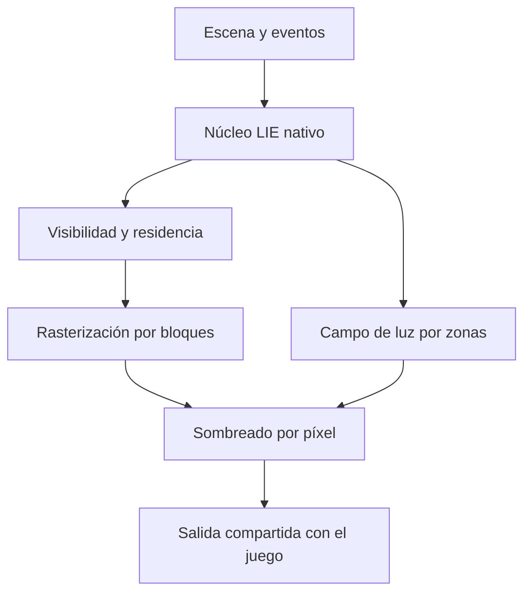

# LIE: auditoría de cuellos de botella, integración nativa y portabilidad

Fecha: 8 de noviembre de 2026. Alcance principal: la ruta de construcción de
la APK 6.3.0. Código del runtime aceptado:
`3aacb5e58034042f9a8e9c19a7bcf4e8b7823054`.

## 1. Resultado de la investigación

El coste dominante observado está en reconstruir visibilidad y acumular la
apariencia de las muestras. La evidencia disponible no respalda atribuirlo
principalmente a ofuscación ni a que los shaders estén escritos en GDScript:
los shaders son GLSL compilado a SPIR-V y los ejecuta el driver de la GPU.

Se construyó un ejecutor independiente en C++17/Vulkan. Repite los mismos
binarios SPIR-V y los mismos bytes de entrada exportados de Godot. En el
control por software, retirar Godot conservó prácticamente todo el tiempo de
los dos pases estudiados. Los buffers de profundidad, propietario y material
coincidieron byte por byte. Esto identifica un problema en el trabajo que
esos kernels realizan, aunque no descarta costes adicionales de Godot en un
juego más grande ni cuantifica el rendimiento actual del Poco.

El compilador de Arm modela presión de registros y derrames a memoria en
acumulación. Además, el código revela accesos atómicos repetidos por píxel,
un almacenamiento temporal grande, descarte temprano insuficiente de piezas
tapadas y requisitos de buffers que exceden el mínimo de algunas APIs.

La dirección recomendada es un núcleo LIE nativo con formatos y límites
explícitos, integrado inicialmente mediante GDExtension y RenderingDevice.
El cambio decisivo debe ser organizar visibilidad, rasterización y memoria.
Reescribir el mismo trabajo GPU desde C++ conserva su coste.

## 2. Evidencia y límites de las conclusiones

| Evidencia | Qué verifica | Qué queda pendiente |
|---|---|---|
| Informe físico 6.0.1 del Poco, Mali-G720 MC7 | La apariencia GPU dominaba el tiempo de esa versión | Velocidad física de 6.3.0 y de los candidatos |
| Validación 6.3.0 con Vulkan software | Imágenes, profundidad, sombras, cachés y contratos | FPS, consumo y estabilidad en cada GPU real |
| Repetición C++/Vulkan en el mismo host | Coste de los mismos kernels sin Godot; igualdad completa de tres buffers | El resto de un motor dedicado y su rendimiento móvil |
| Mali Offline Compiler en cuatro modelos | Compilación, registros, ocupación estimada y derrames | Contadores y ocupación reales del driver del teléfono |
| Inspección del código y del APK | Rutas, formatos, límites y modo de exportación | Certificación de otras familias y sistemas operativos |

El único informe físico usado aquí es de 6.0.1: apariencia p50 entre unos
512 y 517 ms; transporte directo unos 2.16 ms y dos rebotes unos 4.84 ms en
los eventos medidos. Son intervalos distintos; no se suman percentiles. Esos
tiempos no se trasladan a 6.3.0. La presentación de una imagen reutilizada
tampoco representa una reconstrucción nueva.

Los resultados software proceden de llvmpipe LLVM 21.1.8. Sus segundos no son
FPS estimados del Poco. Las comparaciones entre Godot y C++ se hacen dentro
del mismo host; no se comparan velocidades absolutas entre runners de CI.

## 3. Dónde vive el motor actualmente

En el teléfono se ejecuta dentro de una aplicación Godot 4.7.2. El código se
mantiene en `heliossamuelhernandezreyes/Lie-Engine`, rama
`work/lie-construction-android`. Python prepara y verifica bancos y paquetes;
no reconstruye cada fotograma en el teléfono.

| Capa | Implementación activa | Responsabilidad |
|---|---|---|
| Captura y compilación offline | Python y herramientas de captura | Fuentes, muestras, LOD, contratos, hashes, páginas y campo |
| Aplicación móvil | `lie_construction_proxy_lab.tscn` y sus clases padre | Interfaz, gestos, comandos, estados y pruebas |
| Preparación de escena | GDScript | Instancias, selección visible, versiones, paquetes y enlaces |
| Física y cámara | Godot y proxies LIE | Colisiones, cajas, consultas y limitación del movimiento |
| Coordinación de render | `lie_construction_scene_effect.gd` | CompositorEffect, recursos, cachés, listas y timestamps |
| Apariencia GPU | GLSL/SPIR-V, etapas 1/2/3/4/7/8 | Limpieza, visibilidad, acumulación, sombreado, salida y sombra |
| Transporte GPU | Campo de luz LIE y sus shaders | Superficies, fuentes, generaciones, direcciones y rebotes |
| API gráfica y driver | RenderingDevice de Godot; Vulkan en Android | Compilar pipelines y ejecutar trabajo GPU |
| Telemetría nativa | `liblie_gpu_probe.so`, C++17 | Capacidades y mediciones disponibles; no es el rasterizador |
| Presentación | Texture2DRD y TextureRect | Mostrar la textura producida por LIE |

El compositor usa el RenderingDevice global. La salida es una textura GPU;
el recorrido normal no necesita copiar la imagen completa a CPU. Las lecturas
de buffers/texturas se solicitan en diagnósticos explícitos. Los benchmarks
móviles usan metadatos y timestamps asíncronos.

El laboratorio conserva su propia profundidad, sus propietarios y sus sombras.
Todavía no es una sustitución general de los buffers 3D de Godot para que todo
personaje, partícula, transparencia o efecto nativo participe automáticamente.
El proyecto también contiene laboratorios históricos y de rig: que una pieza
funcione en uno no acredita su integración en esta ruta móvil.

RenderingDevice ya ofrece acceso de bajo nivel; no es equivalente a dibujar
cada ladrillo mediante un nodo de alto nivel. Su disponibilidad depende del
backend. La ruta Compatibility no proporciona este mismo camino de cómputo.
[1][2]

## 4. Verificación del cuello de botella

### 4.1 Separación por pases

Una actualización de cámara de la validación original 6.3.0 registró unos
1884.85 ms de apariencia software. En ese mismo fotograma, proyección y
profundidad sumaron 911.21 ms y acumulación 789.80 ms: aproximadamente el
90.25 % del intervalo. Esa suma se hace dentro del mismo fotograma, no sumando
medianas independientes. Sirve para localizar el trabajo en ese backend.

En el código, cada muestra se proyecta y recorre candidatos de su huella
elíptica. Después se comprueban profundidad, límites y soporte de la captura.
La acumulación aceptada realiza ocho sumas atómicas de componentes, además del
desempate de propietario cuando corresponde. Muchas muestras pueden tocar
las mismas regiones de memoria. Reducir cuerpos físicos no elimina ese trabajo.

El pase de profundidad ya existe y la acumulación ya hace descarte temprano
contra él. El siguiente ahorro requiere evitar más trabajo antes de llegar a
esos recorridos o reorganizar cómo se procesa cada región de pantalla.

### 4.2 Control independiente de Godot

Se exportaron los SPIR-V originales, bancos residentes, límites, parámetros,
instancias y listas de trabajos. El ejecutor C++ crea un contexto Vulkan
independiente y reproduce limpieza, proyección y acumulación.

| Vista, interna 1920² | Muestras de cámara | Godot, mediana de los dos pases | C++ directo, mediana | Buffers finales |
|---|---:|---:|---:|---|
| Conjunto completo | 1,165,568 | 2253.64 ms | 2249.65 ms | Exactos |
| Cercana | 392,960 | 2396.77 ms | 2401.20 ms | Exactos |

Son cinco muestras después del calentamiento, con cámara fija y orden de
bancos alternado. Cada par de intervalos se suma antes de calcular su mediana.
El callback CPU de Godot tuvo medianas de 0.372 y 0.347 ms en esas condiciones.
No representan todas las tareas CPU de un juego.

Una primera ejecución independiente ya produjo el mismo resultado cualitativo:
2268.40 frente a 2247.60 ms en la vista completa. Las diferencias pequeñas
entre caminos están dentro de un experimento corto y no justifican atribuir
una aceleración estable a una API concreta.

El control conserva alcance limitado: no incluye sombras, transporte, sombreado
final, presentación ni lógica de juego. La memoria del replay es visible y
coherente para facilitar la inspección; no es la política recomendada para un
producto móvil. Solicita Vulkan 1.2 como configuración experimental, sin fijar
por ello el mínimo de la arquitectura futura.

Que la vista cercana use menos muestras y tarde más en este control muestra
por qué el número de muestras no basta: sus huellas y el trabajo por píxel
también cambian. Una reducción de invocaciones no equivale al mismo porcentaje
de reducción temporal.

### 4.3 Análisis estático Arm

Se compilaron los seis shaders activos para Mali-G720, G610, G57 y G31:
24 compilaciones. Se usó Mali Offline Compiler 2026.5.0, build 922df8,
incluido en la distribución Arm Performance Studio 2026.6. Se registran los
modelos de driver en los JSON, no se identifican con el driver del Poco.

| Modelo | Registros de acumulación | Ocupación estimada | Bytes de derrame de acumulación |
|---|---:|---:|---:|
| G720 | 64 | 50 % | 40 |
| G610 | 64 | 50 % | 40 |
| G57 | 64 | 50 % | 56 |
| G31 | 64 | 50 % | 124 |

La presión obliga al compilador a conservar parte de los temporales fuera
de los registros. Esto ofrece un objetivo concreto de optimización. No mide
el número real de accesos DRAM ni cuánto del tiempo físico corresponde a esa
causa. Los bucles tienen recorridos dinámicos: las estimaciones de ciclos no
son una predicción del tiempo del fotograma. [3]

### 4.4 Qué queda sin separar

La fracción exacta entre contención atómica, cargas/almacenamientos, derrames,
aritmética y sincronización debe medirse en hardware. Arm documenta estos
riesgos, además de ventajas de compresión y solapamiento que no siempre están
disponibles en rutas de cómputo. Eso orienta la hipótesis, sin sustituir los
contadores del dispositivo. [4][5]

## 5. Memoria y escala

En la esquina se comparten las páginas de captura de los ladrillos. Repetir
una instancia no multiplica por sí mismo el archivo del escaneo. La memoria
temporal de la reconstrucción sí crece con muestras e imagen interna.

| Recurso actual a salida 960 / interna 1920 | Tamaño aproximado |
|---|---:|
| Acumulación, 32 bytes por píxel interno | 112.50 MiB |
| Profundidad y propietario, 8 bytes por píxel | 28.125 MiB |
| Proyecciones, capacidad redondeada de 1,179,648 × 80 bytes | 90.00 MiB |
| Imagen interna RGBA32F | 56.25 MiB |
| Imagen de salida RGBA32F | 14.0625 MiB |
| Mapa de sombra 512², uint32 | 1.00 MiB |
| Fuentes residentes de esta escena | 11.76 MiB |
| Campo de luz de esta escena | 22.99 MiB |

La contabilidad total de recursos solicitados de la prueba ronda 337 MiB.
Las filas no incluyen todos los pequeños buffers y metadatos. No deben
sumarse otra vez RSS, PSS, cachés del driver o fuentes compartidas como si
fueran bloques exclusivos distintos.

Limpiar profundidad, propietario y acumulación toca lógicamente 147,456,000
bytes por reconstrucción de cámara a 1920². A sesenta actualizaciones por
segundo serían unos 8.85 GB/s de escrituras lógicas solo en esa limpieza.
Es una cuenta del formato, no una medición del tráfico externo: las cachés y
el comportamiento del hardware cambian el tráfico real.

La selección 6.3 redujo de 1,165,568 a 392,960 muestras en el encuadre cercano,
pero la capacidad de proyecciones sigue dimensionada con el trabajo completo.
Tampoco libera páginas por el mero hecho de salir del encuadre. Reducir trabajo,
reducir residencia y reducir almacenamiento temporal son decisiones distintas.

Los topes actuales incluyen 2048 instancias y tres millones de muestras; el
campo admite hasta 8192 nodos y ocho fuentes en su configuración actual.
El adaptador pequeño añade un límite propio de 512 nodos. Son límites del
prototipo, no leyes de la arquitectura. Deben sustituirse por presupuestos
locales y comprobaciones de capacidades. El constructor también contiene una
selección de LOD al exceder su presupuesto: esa decisión debe hacerse explícita
y medible, conservando las fuentes originales y la calidad acordada.

## 6. Ofuscación, compresión, oclusión y compilación

Son problemas diferentes:

- **Ofuscación:** no se encontró un transformador de código de ese tipo en la
  exportación revisada. `script_export_mode=2` corresponde a tokens binarios
  comprimidos. Se verificó esa enumeración en el propio Godot 4.7.2. No significa
  que la GPU esté interpretando un script comprimido por cada muestra. [6]
- **Compresión:** puede afectar carga, tamaño y residencia. Los shaders usan
  bancos residentes, sin descomprimir la imagen final cada fotograma.
- **Oclusión:** la jerarquía actual hace selección por encuadre. Una pieza
  completamente tapada puede seguir entrando en proyección. Hace falta una
  prueba conservadora de ocultamiento antes del trabajo detallado. [7]
- **Compilación de pipelines:** produce costes de carga o tirones cuando cambia
  el programa. Los controles calientes estudiados mantienen los mismos
  pipelines; no recompilan el shader en cada giro. La compilación final depende
  de GPU y driver. [8]

La APK se exporta como debug con plantilla oficial. Conviene añadir una
comparación release/debug con los mismos kernels y controles, pero eso no
explica por sí solo el coste que persiste en el ejecutor C++.

Las cajas físicas no se convierten automáticamente en oclusores correctos.
Sus envolventes rellenan algunas juntas y aproximan relieve; usarlas sin una
validación óptica podría eliminar detalles o tapar huecos. Un oclusor debe
respetar la abertura real y descartar únicamente objetos demostrablemente
ocultos. La reducción 781 → 13 es una mejora física independiente.

## 7. Experimentos de corrección ejecutados

Se investigaron dos candidatos sin cambiar los bancos ni los shaders de la
APK aceptada. Ambos conservaron exactamente los tres buffers comparados en
las dos vistas del control nativo.

| Candidato | Cambio | Reducción temporal observada, conjunto / cerca |
|---|---|---:|
| Hoist | Calcular color, normal codificada y rugosidad por muestra antes del bucle de píxeles | 3.80 % / 5.61 % |
| Cache | Calcular material en proyección y guardarlo en cuatro escalares no consumidos del registro existente | 11.28 % / 13.06 % |

Los porcentajes corresponden solo a la suma de los dos pases en llvmpipe,
comparada con el replay original de ese mismo host. No son mejoras de FPS
de Android ni incluyen el resto de la imagen.

El candidato Cache mantiene el registro de 80 bytes y pasa el SID de fuente
de forma explícita a la comprobación de soporte. No cambia el propietario
global ni el origen de los datos. Aun así, el modelo Arm muestra un intercambio:
en G720 baja el derrame de acumulación de 40 a 24 bytes, pero introduce 24
bytes de derrame en proyección. Tampoco desaparece la presión de memoria.
Añadir `restrict` por sí solo no eliminó los derrames en el modelo probado.

**Ningún candidato se adopta automáticamente como mejora universal.** Antes
de promoverlo hacen falta la comparación gráfica completa y una medición
física pareada. Se conservan resultados favorables y negativos. Son cambios
pequeños útiles como control, pero la ganancia medida no resuelve por sí sola
la escalabilidad de un juego.

## 8. Lenguajes e integración recomendados

| Parte | Decisión | Motivo |
|---|---|---|
| Compilación de assets | Mantener Python y herramientas actuales | No domina el coste de cada imagen móvil |
| Núcleo de escena, residencia y planificación | C++17/20 con interfaz estable y datos contiguos | Control de asignaciones, versiones y lotes; compilación ARM64/x86-64 |
| Integración inicial | GDExtension y RenderingDevice global | Código nativo sin reemplazar todo Godot ni copiar resultados a CPU |
| Kernels | Mantener GLSL/SPIR-V como referencia durante la corrección | Cambiar lenguaje anfitrión no reduce el trabajo GPU |
| Portabilidad de shaders | Evaluar traducción existente o una cadena como Slang cuando haya un segundo backend probado | Un formato común ayuda; no garantiza equivalencia ni capacidades |
| Rust/wgpu | Alternativa válida si se elige conscientemente ese ecosistema | Sus backends son útiles, pero exige ajustar formatos y límites; no hay ganancia automática |
| Código específico de fabricante | Opcional y aislado detrás de capacidades | La ruta base debe conservar una alternativa portable |

C++ permite construir bibliotecas nativas y GDExtension evita recompilar Godot
para muchas integraciones. Sigue siendo necesario generar una biblioteca por
plataforma/ABI. No se propone trasladar el cálculo de todos los píxeles a CPU.
La primera migración útil sería el planificador y el manejo de datos que el
perfilador identifique; el cuello GPU necesita otro tratamiento. [9][10]

CUDA no sería una base adecuada para cubrir Mali, Adreno y Apple. Tampoco
resulta conveniente atar el núcleo al ensamblador de una GPU. La API, el
compilador y las variantes de kernels deben expresar capacidades comprobadas.

wgpu ofrece backends Vulkan, Metal, DX12 y otros; eso no hace que doce enlaces
de almacenamiento encajen en los ocho de la configuración base de WebGPU.
Filament es una referencia de ingeniería de render móvil multiplataforma,
no un reemplazo directo del campo y las capturas LIE. [11][12][13]

Slang y SPIRV-Cross pueden ayudar con diferentes lenguajes de destino. La
elección debe incluir soporte de texturas, atomics, precisión y vida de
recursos, además de compilar el texto. No es necesario introducir otra cadena
de compilación para empezar a corregir los kernels actuales. [14][15]

## 9. Compatibilidad: lo que se debe comprobar

La APK auditada es ARM64, mínimo Android API 24, objetivo 36. Declara Vulkan
como característica no obligatoria. Ese manifiesto no garantiza que la ruta
LIE funcione al caer en un renderer sin RenderingDevice. La certificación
actual no cubre todas las GPU que puedan instalar el paquete.

Los tres binarios originales del control tienen cabecera **SPIR-V 1.4**
(`0x00010400`). Ejecutarlos sin recompilar exige Vulkan 1.2, o Vulkan 1.1
con `VK_KHR_spirv_1_4` y sus dependencias habilitadas. No basta con anunciar
Vulkan 1.1 en el manifiesto. Esto describe esos binarios concretos: otro
destino de compilación o backend necesita sus propias pruebas. [22]

Los pases de proyección/acumulación declaran **12 buffers de almacenamiento**.
El mínimo Vulkan Core contempla cuatro; WebGPU fija ocho como valor base.
Hay dispositivos con límites mayores, que deben consultarse. [13][16]

También hay un problema de rango: Vulkan garantiza al menos 128 MiB para un
storage buffer. Tres millones de proyecciones de 80 bytes ocupan 240 millones
de bytes y pueden superar ese límite aunque el contador de trabajo sea
aceptado. El acumulador de 1920² sí cabe en 128 MiB; esto no basta para declarar
portable el conjunto. [16]

El replay software anuncia límites de descriptores mucho mayores que los
mínimos, por lo que pasar allí no acredita GPUs con límites pequeños.

| Ruta propuesta | Requisitos | Estado |
|---|---|---|
| Compute de referencia | SPIR-V compatible, formatos, 12 enlaces, rangos y tamaños comprobados | Ruta existente; certificación física limitada |
| Compute con datos empaquetados | Menos enlaces y buffers acotados/chunks | Diseño necesario para ampliar cobertura |
| Variante avanzada | Subgrupos, precisión reducida o funciones opcionales comprobadas | Optimización opcional con alternativa base |
| Ruta raster portátil | Implementación específica con las capturas y pruebas visuales propias | Pendiente; no aparece al cambiar una opción de Godot |
| Metal / D3D12 / WebGPU | Backend, formatos y validación por plataforma | Capacidades del ecosistema, no certificación de LIE |

Para Android, una política práctica puede basarse en perfiles Vulkan de
Android y comprobar capacidades reales al arrancar. La cobertura debe
distinguir instalación, funciones, calidad y rendimiento. Los porcentajes
de adopción de una API no son porcentajes de dispositivos acreditados para
nuestro renderer. [17][18]

La ruta base debe evitar exigir atomics de 64 bits, bindless o ray tracing para
resolver esta fase. La implementación actual usa atomics uint32. Empaquetar
los buffers puede mejorar compatibilidad; su coste de indexación también
debe medirse. Un dispositivo sin capacidad debe recibir una alternativa
validada o un diagnóstico preciso, conservando la decisión de calidad explícita.

La comprobación inicial también debe incluir tamaños e invocaciones por grupo,
memoria compartida, formatos de imagen y límites de asignación. Godot publica
requisitos mínimos generales para proyectos sencillos; no sustituyen el
contrato particular del renderer LIE. [1][16][23]

## 10. Cómo debe comportarse un renderer dedicado a LIE

Debe ser propietario de su escena óptica, sus presupuestos, la visibilidad,
la residencia y el grafo de pases. La física puede conservar proxies simples,
con propietarios compartidos y representación óptica independiente.

Este diagrama es la propuesta, no una descripción de funciones ya terminadas.
La implementación recomendada tiene estas responsabilidades:

1. **Una escena con IDs estables.** Instancias, bancos, tramos, proxies,
   materiales y superficies del campo comparten propietarios versionados.
   Las transformaciones y cambios locales no reconstruyen todo el mundo.
2. **Residencia y precisión explícitas.** Páginas compartidas por asset,
   presupuestos por dispositivo y detalle evaluado en pantalla. Se conservan
   los originales de alta calidad y se validan derivados.
3. **Visibilidad antes del detalle.** Encuadre, orientación y oclusión por
   grupos; conservar aberturas y mantener selección de sombras independiente.
4. **Trabajo por bloques de pantalla.** Proyectar y asignar candidatos a
   tiles, resolver profundidad y acumular cerca de los píxeles que consumirán
   el resultado. Evaluar acumulación local y escritura final por píxel para
   reducir competencia y temporales globales.
5. **Política de desbordamiento correcta.** Una lista de tile llena necesita
   una continuación o fallback que conserve contribuciones. No se pueden
   descartar muestras silenciosamente para cumplir un presupuesto.
6. **Actualización local de luz.** Separar topología, pose, radiometría y
   fuentes/generaciones. El radio energético acota contribuciones; el
   planificador debe evitar trabajo fuera de ese dominio para materializar
   el ahorro. La visibilidad y las sombras siguen siendo necesarias.
7. **Grafo de recursos y sincronización.** Versionar dependencias y evitar
   barreras innecesarias sin eliminar las obligatorias. Medir separación y
   solapamiento de trabajo de cómputo y raster. [5]
8. **Profundidad y efectos del juego.** Definir cómo personajes, partículas,
   impactos y transparencias consumen profundidad y luz LIE, y cómo sus
   obstáculos actualizan el campo y las sombras.

El banco fotográfico activo describe materiales opacos con color, rugosidad y
normales. Refracción, pelo, transmisión y deformaciones requieren contratos y
validación propios. El campo usa una representación angular aproximada; el
radio energético no ofrece una cota universal de error visual ni elimina el
trabajo necesario para reconstruir superficies y sombras.

Un tile 16 × 16 con cuarenta bytes por píxel representa unos 10 KiB de datos
de trabajo. Esto ilustra el motivo para investigar memoria local, pero el
tamaño óptimo, las listas y la ocupación deben adaptarse al dispositivo. La
rasterización por bloques no garantiza una aceleración para todas las
distribuciones: una ruta híbrida puede ser mejor para ciertos tamaños de
huella. Hay referencias de renderizado por puntos que respaldan investigar
agrupación y reducción de tráfico, sin trasladar sus FPS de escritorio a LIE.
[4][19][20]

Con Godot como anfitrión, el núcleo debería usar el mismo RenderingDevice
global y respetar el hilo de render y las vidas de recursos. Crear otro
dispositivo Vulkan y copiar cada imagen por CPU para mezclarla con Godot
introduciría problemas que el control experimental no pretende resolver.

Un motor completamente independiente además tendría que resolver ventanas,
ciclo de vida Android, entrada, audio, física, navegación, herramientas,
empaquetado y recuperación del dispositivo. Quitar esos servicios antes de
corregir el renderer no está justificado por los tiempos encontrados.

## 11. Orden de corrección y criterios de aceptación

| Prioridad | Trabajo concreto | Evidencia exigida |
|---|---|---|
| 1 | Medir 6.3.0 en el Poco con el informe por pases y eventos repetidos | Tiempos por fase, imágenes nuevas, recursos y límites térmicos disponibles |
| 2 | Consultar capacidades y presupuestar buffers por dispositivo | Probar casos de límite y alternativa explícita; no usar éxito en llvmpipe como acreditación |
| 3 | Descartar grupos realmente ocultos antes de proyectar | Ventanas, puertas, bordes, cámara cercana y orden de bancos conservados |
| 4 | Prototipo por tiles y reducción de temporales/atómicas | Misma escena, fuentes, detalle y dimensiones; medidas pareadas y equivalencia de salida |
| 5 | Migrar planificación caliente y residencia a C++ | Comparar CPU, asignaciones y colas; conservar los mismos kernels de referencia |
| 6 | Integrar profundidad y objetos móviles | Habitación jugable con cámara, puerta, personaje, impactos y dos luces |
| 7 | Evaluar anfitrión independiente | Comparación de aplicación completa que demuestre un beneficio adicional |

La captura física inmediata ya se puede hacer con **Benchmark y copiar informe**
de 6.3.0. La prueba **Probar jerarquía y copiar** separa selección apagada y
encendida. Las sesiones sostenidas sirven para detectar degradación; cuando
una temperatura o frecuencia no sea accesible, se conserva esa ausencia.

La matriz debe incluir familias Mali y Adreno representativas, hardware de
entrada y medio, y cada backend de escritorio/Apple que se pretenda anunciar.
Las pruebas de compilación son una primera capa; luego hacen falta ejecución,
imagen, movimiento, memoria y comportamiento sostenido. Los contadores de
fabricante son útiles cuando están disponibles y deben atribuirse a su ámbito
real, que puede incluir otros procesos. [21]

Para 60 FPS el presupuesto es aproximadamente 16.67 ms por actualización; CPU
y GPU pueden solaparse, por lo que no corresponde sumar indiscriminadamente
sus intervalos. El juego debe dejar margen a lógica, animación, física, audio
y sistema. No hay en esta auditoría una certificación de 60 FPS ni de consumo.

## 12. Qué se hizo y qué no se declara resuelto

Se añadieron un ejecutor C++ funcional, exportación de entradas GPU reales,
validación de hashes completos, dos candidatos reproducibles, análisis de
seis shaders en cuatro modelos Arm y una ejecución automatizada en CI. Las
regresiones Python y las pruebas existentes de construcción volvieron a pasar.
La representación, fuentes y APK 6.3.0 aceptadas se conservaron.

No se presenta un motor de juego independiente terminado, una mejora universal
para todos los drivers ni una medición física que no se haya recibido. El
diagnóstico sí permite tomar una decisión: invertir primero en el trabajo GPU
y en sus datos, con un núcleo nativo verificable; conservar inicialmente los
servicios de Godot. Esa separación permite que el renderer evolucione sin
apostar el proyecto a una reescritura completa sin control de referencia.

## 13. Fuentes primarias y reproducción

Las afirmaciones sobre LIE proceden del código y los JSON incluidos en el
paquete de evidencia. Las referencias siguientes orientan APIs, capacidades
y alternativas; no son benchmarks de nuestro motor.

1. Godot, RenderingDevice: https://docs.godotengine.org/en/stable/classes/class_renderingdevice.html
2. Godot, renderers y cómputo: https://docs.godotengine.org/en/stable/tutorials/rendering/renderers.html y https://docs.godotengine.org/en/stable/tutorials/shaders/compute_shaders.html
3. Arm, Mali Offline Compiler: https://developer.arm.com/Tools%20and%20Software/Mali%20Offline%20Compiler
4. Arm, Nanite y cómputo en Mali: https://developer.arm.com/community/arm-community-blogs/b/mobile-graphics-and-gaming-blog/posts/mali-and-unreal-engine-s-nanite-enabling-the-future-of-mobile-graphics
5. Khronos, barreras y GPUs por tiles: https://docs.vulkan.org/samples/latest/samples/performance/pipeline_barriers/README.html
6. Godot, enum y exportador GDScript: https://github.com/godotengine/godot/blob/master/editor/export/editor_export_preset.h y https://github.com/godotengine/godot/blob/master/modules/gdscript/register_types.cpp
7. Godot, oclusión: https://docs.godotengine.org/en/stable/tutorials/3d/occlusion_culling.html
8. Godot, compilación de pipelines: https://github.com/godotengine/godot-docs/blob/master/tutorials/performance/pipeline_compilations.rst
9. Godot, GDExtension C++: https://docs.godotengine.org/en/stable/tutorials/scripting/cpp/gdextension_cpp_example.html
10. Godot, godot-cpp frente a módulos: https://docs.godotengine.org/en/stable/tutorials/scripting/cpp/about_godot_cpp.html
11. wgpu, backends: https://wgpu.rs/doc/wgpu/documentation/features/index.html
12. Filament: https://github.com/google/filament
13. WebGPU, límites: https://gpuweb.github.io/gpuweb/
14. Slang, destinos: https://docs.shader-slang.org/en/stable/external/slang/docs/user-guide/09-targets.html
15. SPIRV-Cross: https://github.com/KhronosGroup/SPIRV-Cross
16. Vulkan, límites requeridos y descriptores: https://docs.vulkan.org/refpages/latest/refpages/source/Required_Limits.html y https://registry.khronos.org/vulkan/specs/latest/man/html/VkPipelineLayoutCreateInfo.html
17. Android, soporte de motores nativos: https://developer.android.com/games/develop/vulkan/native-engine-support
18. Android, perfiles Vulkan: https://developer.android.com/ndk/guides/graphics/android-vulkan-profile
19. Schütz, Kerbl y Wimmer, 2021: https://www.cg.tuwien.ac.at/research/publications/2021/SCHUETZ-2021-PCC/
20. Schütz y colaboradores, 2022: https://www.cg.tuwien.ac.at/research/publications/2022/SCHUETZ-2022-PCC/
21. Arm, herramientas de perfilado: https://developer.arm.com/tools-and-software/arm-performance-studio
22. Khronos, SPIR-V 1.4 y promoción a Vulkan 1.2: https://docs.vulkan.org/refpages/latest/refpages/source/VK_KHR_spirv_1_4.html
23. Godot, requisitos generales y alcance: https://docs.godotengine.org/en/stable/about/system_requirements.html

Control original: run 42515358681, commit
`1b1b88d0775549394e5ac6390bc6fdae503c8644`. Control con candidatos:
run 42516527201, commit `e12ad5f85fc6d9afaecb88228e6aff0997344377`.
Las instrucciones reproducibles están en `native/architecture_audit/README.md`.
