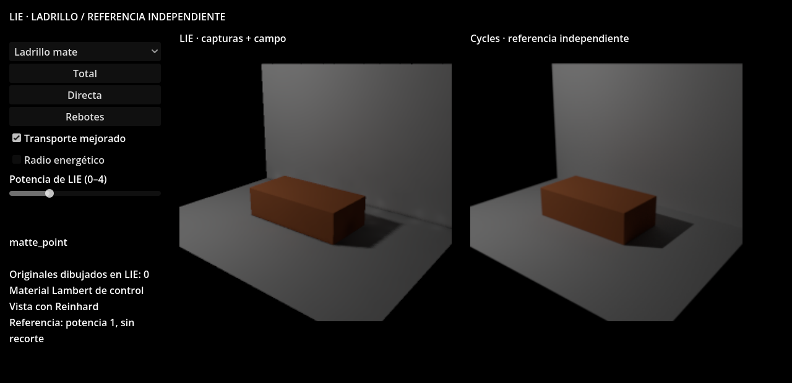

# Ladrillo LIE frente a una referencia independiente

Este laboratorio usa exactamente el generador dimensional de LIE-28 para el
ladrillo: 0.24 × 0.07 × 0.12 m, bisel físico de 1.5 mm y dos segmentos. Conserva
los maestros Blender, el GLB del ladrillo y una descripción de las superficies
fuente. Es una pieza de control de autoría, con material mate uniforme. Todavía
no es una aceptación de fotogrametría, texturas, desplazamiento o brillo estrecho.

## Dos rutas sobre la misma fuente

| Componente | Referencia | LIE |
|---|---|---|
| Superficie visible | Malla original renderizada por Cycles CPU | Capturas neutras de la misma malla, ABI común de 80 bytes |
| Cámara | Perspectiva cuadrada, FOV vertical 42° | Misma posición, orientación y FOV |
| Material de control | Diffuse BSDF explícito, Lambert | Albedo lineal capturado; consumidor diagnóstico Lambert directo + indirecta del campo |
| Luz puntual | Fuente puntual con radio cero | Canal puntual común, misma potencia RGB; alcance 100 m |
| Panel de área | Rectángulo continuo, una cara | Cuadratura existente de cuatro puntos, ganancias hemisféricas comunes |
| Rebotes | Cycles `max_bounces=3`, `diffuse_bounces=3` | Tres generaciones del campo común |
| Visibilidad indirecta candidata | Intersecciones durante el trazado | Grafo compilado offline contra las superficies fuente |
| Visibilidad directa del campo | Geometría original | Triángulos fuente explícitos en el búfer del campo, como control del experimento |
| Sombra fina por píxel | Trazado de caminos | Mapas por canal reconstruidos de las capturas |

No se dibuja ninguna malla fuente en la ruta LIE. **El campo sí conserva sus
triángulos para la consulta directa** en este control. No se oculta ese uso ni
se presenta el resultado como aceptación de una visibilidad basada exclusivamente
en capturas. Las métricas del laboratorio declaran esa cantidad de triángulos.



Se reutilizan `lie_field_quality_transport.gd`, sus fuentes, presupuestos pasivos,
separación por lámpara, bridge de directa y contrato CSR. El consumidor nuevo
deriva de LIE-28 y conserva su reconstrucción por muestras y soporte de caras.
La interpolación usa `lie_irradiance_stencil.glslinc`. El núcleo común no contiene
dimensiones ni cantidades de ladrillos. Los consumidores anteriores no cambian.

El transporte conserva su aproximación Schlick/brillante pasiva, incluso cuando
se declara IOR 1; la referencia mate es Lambert explícito. Esa diferencia de
modelo se mide; no se ajusta el render de referencia para ocultarla. El GLB
exporta el material PBR declarado por glTF; el Blend conserva el Lambert exacto
utilizado por Cycles. Se conservan geometría y albedo de ambos.

## Escenas

| Escena | Pregunta que permite examinar |
|---|---|
| `calibration_plane` | ¿Coinciden cámara, unidades y caída puntual con Lambert analítico? |
| `matte_point` | ¿Qué error introducen captura, sombra y campo en el ladrillo con suelo y pared? |
| `grazing_point` | ¿Qué ocurre con iluminación rasante y sombras largas? |
| `two_bricks` | ¿Se conservan instancias independientes y transporte entre piezas? |
| `blocker_left`, `blocker_right` | ¿Cómo cambia la solución al colocar el obstáculo en dos lugares? |
| `area_panel` | ¿Qué diferencia hay frente a un emisor rectangular continuo? |
| `wall_opening` | ¿Pasan la luz y sus sombras por una abertura geométrica real? |

Las dos posiciones del obstáculo son escenas estáticas recompiladas. No prueban
movimiento continuo, destrucción ni actualizaciones parciales de enlaces. El
laboratorio expone cambios de potencia, política angular, radio y canal mostrado
mediante `command()`; la UI y las pruebas usan esa misma entrada validada.

Las superficies conservan todos sus lados, incluidos los invisibles desde la
cámara. Cada grupo de interpolación pertenece a una cara fuente autorada y a
una instancia: no se unen caras coplanares situadas a ambos lados del hueco.
La cuadratura biseca triángulos y conserva exactamente su área. El objetivo de
arista es 75 mm, con parada explícita a 0.0025 m² para triángulos finos; por ello
algunos triángulos pueden exceder esa longitud. No se eliminan biseles para
entrar en la capacidad de 1024 nodos.

## Medidas y criterios

Se guardan RGBA float32 lineales de directa, indirecta y total. La indirecta de
Cycles se obtiene restando renders con rebotes y directa; puede incluir residuos
de Monte Carlo con signo. Se repiten ambos renders con semillas 71 y 193. El
workflow final usa 512 muestras por semilla, sin denoising, mundo negro y sin
recorte de intensidad. La media de ambas semillas es la referencia comparada.

No se ajusta exposición, histograma, gamma o escala para mejorar las cifras.
Reinhard y sRGB se aplican únicamente a las vistas. La figura de error tiene
ganancia fija ×8. La potencia de la referencia permanece en 1× al modificar la
potencia de LIE en la UI; se indica junto a los controles.

El error L1 relativo es `sum(abs(LIE - referencia)) / sum(abs(referencia))`.
Se informa también MAE, RMSE, sesgo RGB medio y máximo absoluto. La máscara se
fija con la referencia, erosionada dos píxeles; los agujeros de LIE dentro de
esa máscara siguen contando como cero. Se publica además IoU de cobertura y
errores por objeto, para no esconder pérdidas de silueta ni errores locales.

La diferencia entre las dos semillas proporciona una estimación empírica de
ruido; dos semillas no constituyen una cota estadística certificada. En zonas
casi negras un porcentaje relativo grande puede acompañar un error absoluto
pequeño: ambos se conservan. Ningún promedio global certifica todos los detalles.

Controles declarados: error L1 de Cycles frente a Lambert analítico <1 %, LIE
frente al mismo control <3 %, IoU del plano >97 %. Después de encontrar el fallo
de cobertura se añadió una regresión específica: directa de la abertura <15 %
de L1 relativo. **Pasar estos controles no acepta la fidelidad de toda la escena**:
el informe conserva `scene_fidelity_accepted: false` y todos los errores medidos.

El caso mate usa un sector activo en todos sus materiales. Con el radio apagado,
la comparación angular anterior/mejorada debe coincidir aquí. Esta fase no
demuestra la ventaja de seis sectores en superficies brillantes; ese contraejemplo
pertenece a las pruebas del campo y requiere otra referencia de material.

## Hallazgo de sombras conservado

El primer consumidor heredó el splat fijo de 3 × 3 texeles de sombra de LIE-28.
Cuando la huella de una captura ocupa más texeles, deja huecos que aparecen como
una cuadrícula de luz detrás de una pared. En la referencia preliminar de 128
muestras, la directa de `wall_opening` tenía L1 relativo de 449 %. Con cobertura
completa y recorte por la misma cara fuente bajó a 7.49 %. La indirecta quedó
inalterada, lo que separa el fallo de sombra de las aproximaciones del campo.

El generador nuevo calcula el alcance proyectado de cada muestra y comprueba el
soporte de su cara en cada texel. Se mantienen las muestras, posiciones, radios,
fuentes y referencia. La corrección pertenece al consumidor del laboratorio;
no se afirma haber actualizado todos los shaders históricos de LIE-28.

El modo anterior se puede reconstruir exactamente:

```bash
PYTHONPATH=tools python tools/lie_brick_reference_shader.py \
  --legacy-shadow-footprint --output /tmp/lie-brick-legacy.glsl
```

Su SHA-256 es
`49def9a073229802ce86ad0e0a313dfee9cf5e08e6fcf341212f4273d9170755`.
La reproducción se contrastó byte a byte con el shader que produjo el negativo.
No es el shader generado predeterminado.

## Reproducción

Se requieren Blender 4.3.2, Godot 4.7.2 y las dependencias Python declaradas.
El workflow verifica el SHA oficial del binario Blender. Los bancos grandes y
los float32 permanecen en el artifact; el código y la evidencia compacta se
conservan en Git.

```bash
python -m pip install -r requirements-ci.txt
blender -b -t 4 --python tools/lie_brick_reference_blender.py -- \
  --output /tmp/brick-fixture --resolution 256 --samples 512 --capture-resolution 128
PYTHONPATH=tools python tools/lie_brick_reference_verify.py --fixture /tmp/brick-fixture
PYTHONPATH=tools python tools/lie_brick_reference_stage.py \
  --fixture /tmp/brick-fixture --stage /tmp/brick-stage
godot --headless --path /tmp/brick-stage --editor --import --quit
godot --path /tmp/brick-stage --rendering-method mobile --rendering-driver vulkan \
  --script res://test_lie_brick_reference.gd
PYTHONPATH=tools python tools/lie_brick_reference_compare.py \
  --stage /tmp/brick-stage --output /tmp/brick-comparison
```

Para abrir la comparación nativa con controles:

```bash
godot --path /tmp/brick-stage --rendering-method mobile --rendering-driver vulkan
```

Los directorios de salida aislados deben ser nuevos. Los archivos fuente
Blender/GLB permanecen fuera del árbol importado; sus capturas y referencias se
leen como datos. Así, importar la aplicación no intenta abrir un diálogo del
importador Blender ni convierte las referencias numéricas en texturas de juego.

La verificación independiente comprueba 1500 puntos de las capturas contra
triángulos fuente, conservación de área, pertenencia de grupos y dimensiones
del GLB. Las pruebas nativas comprueban descomposición directa+indirecta,
apagado, caché, restauración de potencia/política, UI y rechazo de revisiones.

La validación Vulkan por software certifica ejecución y resultados del
experimento. No establece FPS, memoria total ni calentamiento en Android.
Esta etapa no construye una APK ni integra V6.

## Resultados finales

Código validado: `aab8c2a003041533cba1b3165b01eaaeb8e4e5eb`.
[Ejecución completa aprobada](https://github.com/heliossamuelhernandezreyes/Lie-Engine/actions/runs/42247946881),
job `127995026809`. Godot 4.7.2, Cycles/Blender 4.3.2,
Vulkan 1.4.335, llvmpipe LLVM 21.1.8 / Mesa 26.0.8.

| Escena | L1 total | L1 directa | L1 indirecta |
|---|---:|---:|---:|
| Plano de calibración | 0.21 % | 0.21 % | Sin indirecta |
| Ladrillo mate | 1.42 % | 0.43 % | 12.92 % |
| Luz rasante | 2.14 % | 0.42 % | 18.99 % |
| Dos ladrillos | 1.76 % | 0.50 % | 19.96 % |
| Obstáculo izquierdo | 1.61 % | 0.47 % | 15.02 % |
| Obstáculo derecho | 1.64 % | 0.53 % | 14.97 % |
| Panel de área | 1.60 % | 0.66 % | 14.49 % |
| Abertura con fuente detrás | 57.06 % | 7.45 % | 225.32 % |

Son errores sobre los interiores de la máscara de referencia descrita arriba.
Los bordes se evalúan aparte: IoU entre aproximadamente 98.3 % y 98.9 %.
La separación por canal muestra que una directa dominante puede hacer pequeño
el error total mientras persisten diferencias considerables en los rebotes.
La abertura es un caso adverso real de esta representación. No se elimina de
las cifras ni se atribuye su causa exclusivamente a una de las aproximaciones.

Los [datos completos](checkpoints/lie-brick-reference/comparison.json) incluyen
errores absolutos, sesgos, regiones y ruido por semilla. Por ejemplo, en el caso
mate el ruido RMSE estimado de la referencia media sobre el interior ronda
`2.68e-4` para la indirecta; no se supone que todo el error frente a esa imagen
sea sesgo del modelo. Las superficies casi negras se interpretan junto con sus
valores absolutos, no sólo por su porcentaje.

| Validación | Resultado |
|---|---|
| Python completo | 253 contabilizadas: 252 aprobadas, 1 omitida por fuente opcional de otro laboratorio |
| Rig / sesión de agente | 247 / 25 comprobaciones aprobadas |
| Laboratorio nativo | 148 comprobaciones aprobadas, ocho escenas, UI real y lectura GPU |
| Captura frente a fuente | 1500 puntos; distancia numérica máxima `2.9010698199272156e-7` m |
| Controles analíticos / abertura | Cuatro criterios aprobados |
| Restauración de política y potencia | Diferencia máxima cero en todos los casos |
| Fuentes apagadas | RGB máximo cero en todos los casos |
| Errores de script, liberación y fugas en registros de aceptación | Ninguno detectado |

## Fallo nativo aislado y resuelto

La primera versión pasó localmente en Mesa 25 / LLVM 19 y sufrió SIGSEGV en
Mesa 26 / LLVM 21. Separar las seis etapas de cámara no bastó. Los prefijos de
diagnóstico demostraron que el campo común completo y la cámara hasta la etapa
3 pasaban; añadir el sombreado de píxel de la etapa 4 reproducía el cierre.

La versión final añade una prefase GPU por nodo que calcula la misma resta
`irradiancia_total - irradiancia_directa`. El píxel interpola su resultado
residente en vez de repetir la resta dentro de los bucles de fuentes y grupos.
Se conservan referencias, materiales, ecuaciones y tolerancias. Así pasó Mesa
26. En Mesa 25, las 40 imágenes float32 de los ocho casos coinciden exactamente
con la versión anterior, tanto al separar kernels como al añadir la prefase.
Esta es una corrección reproducible de la organización del cálculo; no identifica
concluyentemente un defecto particular del compilador.

El [checkpoint](checkpoints/LIE_BRICK_REFERENCE_CHECKPOINT.json) conserva los
tres runs fallidos, sus artifacts y el diagnóstico. También conserva el
[contraejemplo del splat 3×3](checkpoints/lie-brick-reference/preliminary-fixed3x3.json)
y la [comparación controlada de su corrección](checkpoints/lie-brick-reference/shadow-footprint-regression.json).

Las referencias finales fueron producidas en el run inicial cuya **preparación
de fuentes** pasó; su etapa nativa fallida no cuenta como aceptación. Los runs
posteriores reutilizan esos bytes sólo cuando no cambian las recetas pertinentes,
validan otra vez hashes y geometría, y vuelven a ejecutar toda la aceptación
nativa. La generación fresca sigue disponible en el comando de reproducción.

El artifact final `13519621961` ocupa `48,090,364` bytes; SHA-256
`c99848a6f0d3a9248980e08e75f9a95de1e38d478ea678420285c9d5c898b3ed`.
Contiene los maestros editables, banco, referencias EXR/NumPy, lecturas GPU,
figuras y registros. Al descomprimirlo, `tmp/brick-fixture` es el argumento
`--fixture` del preparador; el código se obtiene de la rama de GitHub.

La siguiente revisión arquitectónica queda centrada en la resolución espacial,
la interpolación y la respuesta de los rebotes cerca de aberturas. La aceptación
fotográfica, los materiales brillantes y el rendimiento Android conservan sus
pruebas independientes pendientes.
